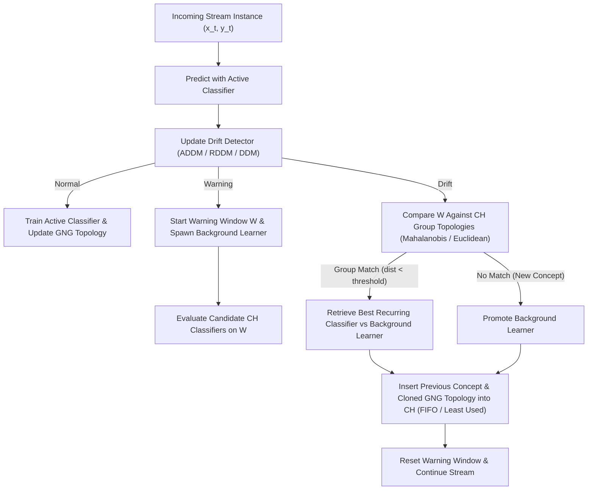

# GroCH - MOA & CapyMOA

[](https://github.com/cetrulin/groch-moa/actions/workflows/ci.yml)
[](LICENSE)

MOA 2024.07 and CapyMOA implementation of **GroCH** (Growing Concept History), along with **GNG** (`moa.clusterers.gng`), **ADDM** (dual-ADWIN drift/warning detector), **iGNGSVM**, and **RCARF**.

- Original iGNGSVM paper ([Neurocomputing, 2017](https://www.sciencedirect.com/science/article/pii/S0925231217309852)): [Data-Streams-Online-Classification-WEKA-MOA-Algorithms](https://github.com/cetrulin/Data-Streams-Online-Classification-WEKA-MOA-Algorithms).
- Additional RCARF variants from the PhD thesis *Adaptive Algorithms For Classification On High-Frequency Data Streams: Application To Finance*: [RCARF](https://github.com/cetrulin/RCARF).

## How GroCH Works

GroCH pairs an online base classifier and drift detector with Growing Neural Gas (GNG) topology summaries stored in a grouped Concept History (CH):



## Requirements

- **MOA 2024.07** ([SourceForge](https://sourceforge.net/projects/moa-datastream/files/MOA/2024%20July/), [GitHub](https://github.com/Waikato/moa)) and **JDK 21+** (for CapyMOA's bundled `moa.jar`; JDK 8+ for standalone MOA).
- **CapyMOA >= 0.15.0** and **Python 3.11+** for the Python wrapper and pytest suite.
- Legacy **MOA 2017.06** ([SourceForge](https://sourceforge.net/projects/moa-datastream/files/MOA/2017%20June/moa-release-2017.06b.zip/download)) builds are preserved on tags `v0.1-moa2017.06` through `v1.0.0-moa2017.06`.

Tested on macOS (Apple Silicon, zsh/bash) and RHEL 9 (EL9) x86_64 SLURM clusters.

## Quickstart (MOA + CapyMOA)

```bash
# 1. Build a MOA 2024.07 fat JAR with GroCH, GNG, ADDM, and distance strategies
./scripts/build_moa_jar.sh ./moa_with_groch.jar python3

# 2. Run the CapyMOA pytest suite
export CAPYMOA_MOA_JAR="$(pwd)/moa_with_groch.jar"
PYTHONPATH="$(pwd)/capymoa_upstream/src/capymoa/classifier" pytest capymoa_upstream/tests/test_groch.py -v
```

### Python (CapyMOA)

```python
from capymoa.datasets import ElectricityTiny
from capymoa.evaluation import prequential_evaluation
from _groch import GroCH  # or: from capymoa.classifier import GroCH

stream = ElectricityTiny()
learner = GroCH(
    schema=stream.get_schema(),
    base_learner="trees.HoeffdingTree",
    distance_metric="Euclidean",
    console_log_level=0,
)
results = prequential_evaluation(stream=stream, learner=learner, max_instances=1000)
print(f"Accuracy: {results.cumulative.accuracy():.2f}%")
```

### CLI & SLURM (MOA)

Run `meta.GroCH` directly on an ARFF stream with `experiments/run_groch.sh`:

```bash
MOA_JAR=./moa_with_groch.jar ./experiments/run_groch.sh \
  --arff data/data.arff \
  --base-learner "trees.HoeffdingTree" \
  --drift "RDDM -o 2.0" \
  --distance "Euclidean" \
  --out results/groch.csv
```

Or submit a SLURM job array:

```bash
MOA_JAR="$(pwd)/moa_with_groch.jar" ARFF="/path/to/data.arff" \
  sbatch experiments/submit_slurm_groch.sbatch --distance Mahalanobis
```

To launch the MOA GUI with GroCH compiled into the fat JAR:

```bash
java -Xmx2g -cp ./moa_with_groch.jar moa.gui.GUI
```

Full parameter descriptions are in Appendix A of the thesis and via `learner.cli_help()`. The 2021 MOA 2017.06 `meta.NA` sweep scripts are preserved verbatim on tags `v0.1-moa2017.06` and `v1.0.0-moa2017.06`.

## Data Generators

Data preprocessing and synthetic stream generators used in the thesis: [Quant-Quote-Data-Preprocessing](https://github.com/cetrulin/Quant-Quote-Data-Preprocessing) and [regime-switching-series-generator](https://github.com/cetrulin/regime-switching-series-generator).

## Versions & Releases

| Tag | Target | Notes |
| :--- | :--- | :--- |
| `v0.1-moa2017.06` | MOA 2017.06 | Original code used in the *Neurocomputing* (2026) paper |
| `v0.5-moa2017.06` | MOA 2017.06 | Pre-optimization baseline with deep `GNG`/`Topology` cloning and Fritzke (1995) edge fix |
| `v1.0.0-moa2017.06` | MOA 2017.06 | Bit-exact Fritzke (1995) optimizations, `ConceptDistance`/`DriftEventLogger`, `moa.clusterers.gng`, JUnit tests, Apache 2.0 |
| `v2.0.0-moa2024.07` | MOA 2024.07 | `CapabilitiesHandler`, `long measureByteSize()`, self-contained `PerGroupMahalanobisDistance`, self-contained JUnit tests |
| `v3.0.0-capymoa` | MOA 2024.07 + CapyMOA | `NA` renamed to `GroCH`, `scripts/build_moa_jar.sh`, CapyMOA `GroCH` wrapper & pytest suite |

## Citation

```bibtex
@article{suarez2026growing,
  title   = {A growing concept history of recurring classifiers for high-frequency data streams},
  author  = {Suarez-Cetrulo, Andres L. and Cervantes, Alejandro and Quintana, David},
  journal = {Neurocomputing},
  volume  = {684},
  pages   = {133506},
  year    = {2026},
  doi     = {10.1016/j.neucom.2026.133506}
}
```
