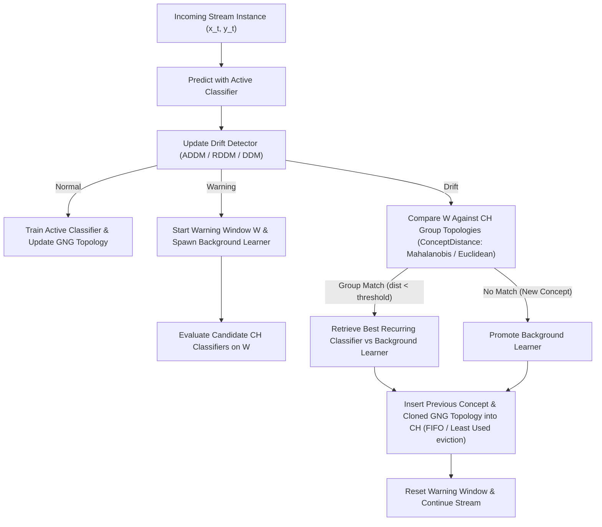

# GroCH - MOA & CapyMOA Implementation

[](https://github.com/cetrulin/groch-moa/actions/workflows/ci.yml)
[](LICENSE)

This repository contains the implementation of GroCH, iGNGSVM and RCARF, and scripts to run parameter-tuning for the MOA implementation GroCH in an HPC cluster using SLURM. 

- The original implementation of iGNGSVM from the paper [*An online classification algorithm for large scale data streams: **iGNGSVM***](https://www.sciencedirect.com/science/article/pii/S0925231217309852?casa_token=1quuIWzSuV8AAAAA:z9vWMavVc4hIiCSeazenq4kWSowtocF7hMYUd3uy-eprEEYiMiw__QXJbkm2lDmUguk127hAjw) can be found in the repository [Data-Streams-Online-Classification-WEKA-MOA-Algorithms](https://github.com/cetrulin/Data-Streams-Online-Classification-WEKA-MOA-Algorithms).
- Extra implementation and variants of the RCARF algorithm, mentioned in the appendix of the thesis **Adaptive Algorithms For Classification On High-Frequency Data Streams: Application To Finance**, can be found in the repo [RCARF](https://github.com/cetrulin/RCARF).

This repository also contains the ADDM drift detector, which consists of two embedded ADWIN confidence intervals under the same detector. One to signal warnings and another for concept drifts.

Older versions of GroCH are referred as 'NA'/'NA.java' in the scripts.

## How GroCH Works

GroCH (**Growing Concept History**) handles recurring concept drifts in evolving data streams by pairing an online base classifier and drift detector with **Growing Neural Gas (GNG)** topology summaries stored in a grouped **Concept History (CH)**:




## Dependencies: 

In order to run the algorithms contained in the folder `src`, Massive Online Analysis (MOA) and Java are needed:

- [**MOA version 2024.07**](https://sourceforge.net/projects/moa-datastream/files/MOA/2024%20July/) *(recommended / current; source code on [Waikato/moa](https://github.com/Waikato/moa))*: `GroCH` (`moa.classifiers.meta.GroCH`), `GroCHChangeDetector`, `moa.clusterers.gng.GNG`, `CapabilitiesHandler`, `long measureByteSize()`, and self-contained `ConceptDistance` strategies (`PerGroupMahalanobisDistance`, `MahalanobisDistanceSingleMatrix`, `EuclideanConceptDistance`) are adapted for and support **MOA 2024.07** (Java 8+; JDK 21+ when building against CapyMOA's bundled `moa.jar`).
- [MOA version 2017.06](https://sourceforge.net/projects/moa-datastream/files/MOA/2017%20June/moa-release-2017.06b.zip/download) *(legacy)*: original thesis experiments used [moa-2017.06-sources](https://repo1.maven.org/maven2/nz/ac/waikato/cms/moa/moa/2017.06/) with Java SE 7 (see tags `v0.5-moa2017.06` and `v1.0.0-moa2017.06`).

The folder `experiments` contains bash scripts to run a similar parameter optimisation and experiments than the ones performed in the PhD thesis **Adaptive Algorithms For Classification On High-Frequency Data Streams: Application To Finance**. 

These scripts and MOA builds are currently tested on **macOS** (Apple Silicon, zsh/bash) and **Linux HPC** environments running **Red Hat Enterprise Linux 9 (RHEL 9 / EL9)** on both login and x86_64 multi-core compute nodes managed by **SLURM**. Legacy experiments were also tested under Windows Subsystem for Linux ([WSL](https://docs.microsoft.com/en-us/windows/wsl/install)) and older macOS bash shells (WSL requires an X11 server such as [Xming](https://sourceforge.net/projects/xming/) or [XLaunch](https://x.cygwin.com/docs/xlaunch/) for the MOA GUI).

The scripts with suffix `_slurm` have been created to trigger experiments in parallel on SLURM (originally created on SLURM 19.05.1-2 and currently executed on RHEL 9 SLURM compute nodes).


## Setup Instructions

After downloading MOA (2024.07 or legacy 2017.06 sources) and installing a compatible JDK, place the algorithms from `src` (and optionally the JUnit tests from `test`) into your MOA source tree and compile all `.class` files. This can be done by mounting the repository in an IDE such as [Eclipse](https://www.eclipse.org/downloads/). Once the `.class` files are available, the algorithms of this repository (`NA`, `GroCH`, `moa.clusterers.gng.GNG`, `ADDM`, etc.) should appear when running MOA through the graphical user interface (GUI) or bash. For this purpose, do not run the standalone moa JAR file alone since this is a source-integrated setup.

It is recommended to start using MOA's graphical interface, which will show the different parameters supported by the algorithms and different options available to experiment. This can be run with the code below:

```bash
MOA_DEV="."  
EXTRAPATH="./lib/*":"./src/moa/classifiers"
java -Xmx1024m -cp $EXTRAPATH:$MOA_DEV -javaagent:sizeofag-1.0.0.jar moa.gui.GUI
```

For documentation about the use of MOA, [visit this link](https://moa.cms.waikato.ac.nz/documentation/). Data is expected to be fed in ARFF format or as a data stream. Different tools like [WEKA](https://www.wikihow.tech/Convert-CSV-to-ARFF), or libraries like [csv2arff](https://pypi.org/project/csv2arff/) can be used to convert tabular data (e.g. CSV files) to this format. 

Experiments in MOA can also be run through bash or SLURM using the parameterized runners in `experiments/`:

* `experiments/run_groch.sh` — runs `meta.GroCH` on any ARFF stream with configurable base learner, drift detector, distance metric, and GroCH flags.
* `experiments/submit_slurm_groch.sbatch` — portable SLURM job-array wrapper around `run_groch.sh`.

*(The original 2021 MOA 2017.06 `meta.NA` thesis sweep scripts are preserved verbatim in tags `v0.1-moa2017.06` and `v1.0.0-moa2017.06`.)*

For in-detail descriptions of the parameters of these algorithms, check the PhD thesis **Adaptive Algorithms For Classification On High-Frequency Data Streams: Application To Finance**. Appendix A, in this thesis, lists all the paremeters of the MOA code of GroCH. It also lists important parameters and values for this algorithm and its competitors.

A simpler script to run one of the algorithms of this thesis can be seen below. In the script above, the dataset is read from the file `data.arff` in the folder `data`. The results are outputted to a `log` folder.

```bash
MOA_DEV="."

java -cp "$MOA_DEV/lib/*":$MOA_DEV/moa:$MOA_DEV/weka -javaagent:$MOA_DEV/sizeofag-1.0.0.jar moa.DoTask \
"EvaluateInterleavedTestThenTrain \
 -l (igngsvm.IGNGSVM -t 1500 -e 0-Q 0.0025 -n 3 -T 1 -X 0
 -b (weka.classifiers.functions.LibSVM -S 0 -K 0 -D 1 -G 0.0 -R 0.0 -N 0.5 -M 40.0 -C 8.0 -E 0.0010 -P 0.1 -model $MOA_DEV)) \
 -s (ArffFileStream -f $MOA_DEV/data/data.arff) \
 -e (BasicClassificationPerformanceEvaluator) \
 -f 1500" > $MOA_DEV/logs/test.txt
```

## Reproducible CapyMOA Integration

This repository includes a full [CapyMOA](https://capymoa.org/) `MOAClassifier` wrapper (`capymoa_upstream/src/capymoa/classifier/_groch.py`), pytest test suite (`capymoa_upstream/tests/test_groch.py`), upstream CapyMOA patches, and a one-command fat-JAR build script (`scripts/build_moa_jar.sh`).

### Quickstart (Local / HPC)

```bash
# 1. Build a custom CapyMOA fat JAR containing GroCH, GNG, ADDM, and distance strategies (JDK 21+)
chmod +x scripts/build_moa_jar.sh
./scripts/build_moa_jar.sh ./moa_with_groch.jar python3

# 2. Point CapyMOA to the custom JAR
export CAPYMOA_MOA_JAR="$(pwd)/moa_with_groch.jar"

# 3. Run the CapyMOA pytest suite
PYTHONPATH="$(pwd)/capymoa_upstream/src/capymoa/classifier" pytest capymoa_upstream/tests/test_groch.py -v
```

### Python Usage

```python
from capymoa.datasets import ElectricityTiny
from capymoa.evaluation import prequential_evaluation
from _groch import GroCH  # or `from capymoa.classifier import GroCH` once integrated into CapyMOA

stream = ElectricityTiny()
learner = GroCH(
    schema=stream.get_schema(),
    base_learner="trees.HoeffdingTree",
    distance_metric="Euclidean",
    console_log_level=0,
)
results = prequential_evaluation(stream=stream, learner=learner, max_instances=1000)
print(f"Accuracy: {results.cumulative.accuracy():.2f}%")
```

## Data Used In The Scripts

Scripts and instructions to generate the data used in the PhD thesis **Adaptive Algorithms For Classification On High-Frequency Data Streams: Application To Finance** can be found in the GitHub repositories [Quant-Quote-Data-Preprocessing](https://github.com/cetrulin/Quant-Quote-Data-Preprocessing) and [regime-switching-series-generator](https://github.com/cetrulin/regime-switching-series-generator).

## Versions & Releases

| Tag | Target Framework | Highlights |
| :--- | :--- | :--- |
| `v0.1-moa2017.06` | MOA 2017.06 | Original implementation used in the *Neurocomputing* (2026) paper |
| `v0.5-moa2017.06` | MOA 2017.06 | Pre-optimization baseline with deep `GNG`/`Topology` cloning and Fritzke (1995) edge removal fix |
| `v1.0.0-moa2017.06` | MOA 2017.06 | Bit-exact Fritzke (1995) performance optimizations, `ConceptDistance`/`DriftEventLogger` refactor, `moa.clusterers.gng`, JUnit tests, Apache 2.0 |
| `v2.0.0-moa2024.07` | MOA 2024.07 | MOA 2024.07 API (`CapabilitiesHandler`, `long measureByteSize()`), self-contained `PerGroupMahalanobisDistance` & JUnit tests |
| `v3.0.0-capymoa` | MOA 2024.07 + CapyMOA | Complete `NA` → `GroCH` rename, `scripts/build_moa_jar.sh`, full CapyMOA `GroCH` wrapper & pytest suite |

## Citation

If you use GroCH in your research, please cite:

```bibtex
@article{suarez2026growing,
  title   = {A growing concept history of recurring classifiers for high-frequency data streams},
  author  = {Suarez-Cetrulo, Andres L. and others},
  journal = {Neurocomputing},
  volume  = {684},
  pages   = {133506},
  year    = {2026},
  doi     = {10.1016/j.neucom.2026.133506}
}
``` 
